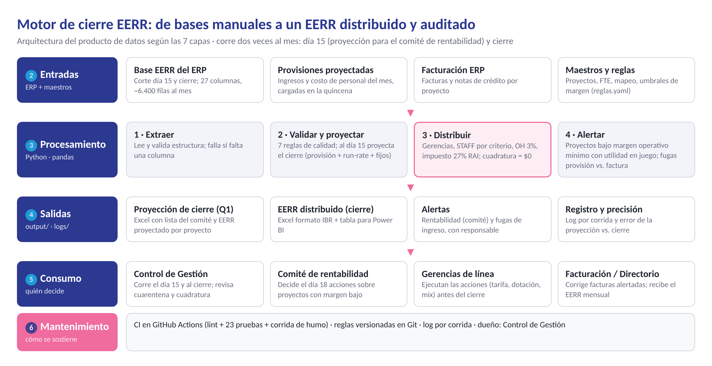

# Motor de cierre EERR con alertas de fuga de ingresos

Producto de datos que automatiza el cierre del Estado de Resultados (EERR) por proyecto de una empresa BPO multipaís
y corre **dos veces al mes**:

- **Día 15 (corte Q1):** con las provisiones proyectadas de ingresos y personal más lo contabilizado a la fecha, proyecta el cierre del mes y entrega al **comité de
  rentabilidad** la lista de proyectos con margen operativo negativo o bajo el mínimo, con la utilidad en juego de cada uno,
  para tomar acciones antes de que termine el mes.
- **Cierre:** consolida la base contable, valida su calidad, distribuye gerencias, STAFF, OH Latam e impuesto a cada
  proyecto con cuadratura exacta, alerta las diferencias entre ingreso provisionado y facturado y mide la precisión
  de la proyección quincenal.

**Autor:** Claudio Choque Peña · Proyecto final individual · Diploma Ciencia de Datos para las Finanzas, FEN U. de Chile

[](https://github.com/clautex8-ux/motor-cierre-eerr/actions)

> **Declaración de datos.** Todos los archivos de `data/` son **sintéticos, anonimizados y escalados** por seguridad de
> la información. Replican la estructura real del extracto EERR del ERP (27 columnas, CSV `;`, latin1) y las reglas de
> negocio del cierre, pero proyectos, clientes y montos son ficticios. Se generan con `motor.generar_datos`.



## Inicio rápido

```bash
pip install -r requirements.txt
export PYTHONPATH=src            # en Windows: set PYTHONPATH=src

python -m motor.generar_datos              # 6 cierres (abr–sep 2026) + cortes Q1 (may–oct) en data/raw
python -m motor.pipeline --mes 2026-10 --corte Q1   # proyección del día 15 para el comité
python -m motor.pipeline --mes 2026-09              # cierre mensual
python -m motor.pipeline --todos                    # todos los cortes y cierres
python -m motor.kpis                                # KPIs IL3, IL4, IL5 -> output/kpis_producto.csv
python -m pytest -q                                 # 23 pruebas de calidad, cuadratura y proyección
```

Con `make`: `make datos`, `make cierre`, `make mes MES=2026-09`, `make kpis`, `make test`, `make lint`.

## Estructura

```
motor-cierre-eerr/
├── config/reglas.yaml          # parámetros de negocio versionados (tasas, criterios, umbrales, línea base)
├── data/
│   ├── raw/                    # Base_EERR, Provision_Ingresos y Facturacion por mes (sintéticos)
│   └── maestros/               # maestro de proyectos (FTE, línea) y mapeo de campañas
├── src/motor/
│   ├── extraer.py              # capa de entrada: lectura y contrato de estructura
│   ├── validar.py              # capa de calidad (IL3): normalización, 7 reglas, cuarentena
│   ├── proyectar.py            # proyección de cierre al día 15 y alertas de rentabilidad
│   ├── distribuir.py           # reglas de distribución con cuadratura exacta
│   ├── alertar.py              # conciliación provisión vs. facturación
│   ├── exportar.py             # Excel formato IBR y tabla para Power BI
│   ├── pipeline.py             # orquestador + registro de ejecución (IL4)
│   ├── kpis.py                 # KPIs del producto por nivel de madurez
│   └── generar_datos.py        # generador de datos sintéticos
├── tests/                      # pytest: validación, distribución, alertas, punta a punta
├── logs/
│   ├── ejecuciones.csv         # una fila por corrida: estado, tiempos, calidad, cuadratura, alertas
│   ├── seguimiento_productividad.csv  # horas de cierre por mes (IL5 secundario)
│   └── seguimiento_comite.csv  # proyectos intervenidos por el comité y margen posterior (IL5 principal)
├── output/                     # Proyeccion_Cierre_AAAA-MM_Q1.xlsx, EERR_Distribuido_AAAA-MM.xlsx,
│                               # comite_rentabilidad_*, precision_proyeccion_*, alertas_*, powerbi/, kpis
├── docs/                       # diagramas (HTML -> PNG) y gráficos del informe
└── .github/workflows/ci.yml    # CI: ruff + pytest + corrida de humo en cada push
```

## Reglas de negocio

| Regla | Qué hace | Base de prorrateo |
|---|---|---|
| Gerencias de línea | Reparte cada fila de "Gerencia X" entre los proyectos de su misma línea | % de ingresos del proyecto en la línea |
| STAFF | Reparte cada fila STAFF según el criterio de la columna `Tabla` | Ingresos Local, Offshore, Local + Offshore o FTE |
| OH Latam | Crea un cargo por proyecto | -3% de los ingresos del proyecto |
| Impuesto a la renta | Crea un cargo por proyecto (los de pérdida generan crédito) | -27% del RAI del proyecto |

La distribución es fila a fila: cada fila origen se reemplaza por N filas destino que conservan toda la información
contable y quedan marcadas en la columna `Cross` (`Cross_gerencia`, `Cross_STAFF`, `Calculo_OH`, `Calculo_Impuesto`).
El redondeo es a pesos y el residuo va al destino de mayor base: **la cuadratura contra el origen es siempre $0**, y si no
lo es la corrida falla sin publicar salidas.

## Proyección quincenal y comité de rentabilidad

Al día 15 el ERP solo tiene parte del mes contabilizada. El motor construye una base proyectada a mes completo y la
distribuye con las mismas reglas del cierre:

| Rubro | Método al corte Q1 |
|---|---|
| Ingresos de explotación y costos del personal | Provisión proyectada del mes completo, cargada por Control de Gestión en la quincena |
| Costos operacionales, offshore, no operacional | Run-rate: lo contabilizado ÷ fracción del mes transcurrida (0,5) |
| Gastos generales fijos | Se mantienen del último cierre del mismo proyecto |

La métrica de decisión del comité es el **margen operativo**: ingresos menos costos de personal, operacionales,
offshore y gastos generales fijos (`rubros_operativos`), **antes de OH Latam, no operacional e impuesto**, que son
distribuciones corporativas que la gerencia del proyecto no controla. El margen neto se informa al lado como referencia.

Los proyectos cuyo margen operativo proyectado queda bajo `rentabilidad.margen_minimo` (5%) entran a la hoja
`Comite_Rentabilidad` con severidad (negativo / bajo), brecha en puntos hasta el objetivo (10%), **utilidad por punto**
(1% de sus ingresos, antes de impuesto) y **utilidad en juego** (brecha × ingresos). Al cierre, `precision_proyeccion_*.csv`
compara el margen operativo proyectado con el real por proyecto (error en pp y acierto de la clasificación).

## Contrato de datos (IL3)

| Regla | Acción si no se cumple |
|---|---|
| R1 proyecto informado | cuarentena |
| R2 código existe en el maestro | cuarentena |
| R3 línea de negocio válida (se corrige desde el maestro si el código existe) | corrección automática o cuarentena |
| R4 monto numérico | cuarentena |
| R5 saldo = haber − debe | cuarentena |
| R6 mes coherente con el archivo | cuarentena |
| R7 fila STAFF con criterio de distribución válido | cuarentena |

Las filas en cuarentena quedan en la hoja `Cuarentena` del Excel con su motivo, para revisión de Control de Gestión.

## KPIs del producto

| Nivel | KPI | Meta |
|---|---|---|
| IL3 | % de filas con proyecto, línea y cuenta válidos | ≥ 99,5% |
| IL3 | Diferencia de cuadratura origen vs. distribuido | $0 |
| IL4 | % de ejecuciones sin error (cortes Q1 + cierres) | ≥ 99% |
| IL4 | Error medio de la proyección de margen operativo vs. cierre | ≤ 5 pp |
| IL4 | Acierto al clasificar proyectos bajo margen operativo mínimo | ≥ 85% |
| IL5 | Puntos de margen operativo recuperados en proyectos intervenidos por el comité | ≥ 3 pp |
| IL5 | Utilidad adicional antes de impuesto por intervenciones (puntos recuperados × ingresos) | > 0 |
| IL5 | Horas de cierre por mes (40 h manual → meta 16 h), secundario | ahorro ≥ 24 h/mes |

**Lógica del IL5.** El margen es resultado ÷ ingresos, así que cada punto de margen operativo que un proyecto mejora,
sea bajando costos (dotación, horas extra, mix) o subiendo tarifa, equivale al 1% de sus ingresos en utilidad adicional
antes de impuesto; sobre la cartera completa, un punto vale 1% de los ingresos mensuales. El comité registra en
`logs/seguimiento_comite.csv` los proyectos intervenidos, su margen operativo proyectado y el real del cierre siguiente;
`motor.kpis` calcula los puntos recuperados y la utilidad generada, y marca el KPI como *Pendiente* mientras no haya
cierres posteriores a la intervención.

## Mantenimiento

- **Versionado:** código y `config/reglas.yaml` en Git; un cambio de tasa o criterio es un commit revisable.
- **CI:** cada push ejecuta lint, pruebas de cuadratura y una corrida de humo; el Excel resultante queda como artefacto.
- **Monitoreo:** `logs/ejecuciones.csv` y `logs/motor.log` registran cada corrida; `motor.kpis` resume el estado.
- **Responsable:** Jefe de Control de Gestión (dueño del producto y de las reglas).
- **Calendario:** día 15 corte Q1 → día 18 comité de rentabilidad → cierre mensual con medición de precisión.
- **Próximo paso:** reemplazar la lectura de CSV por extracción SuiteQL directa del ERP cuando TI habilite el acceso.
